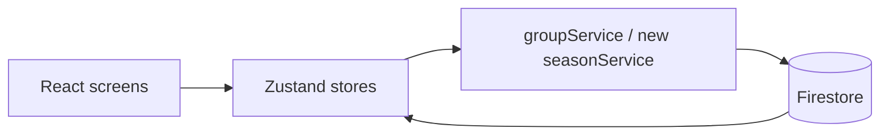
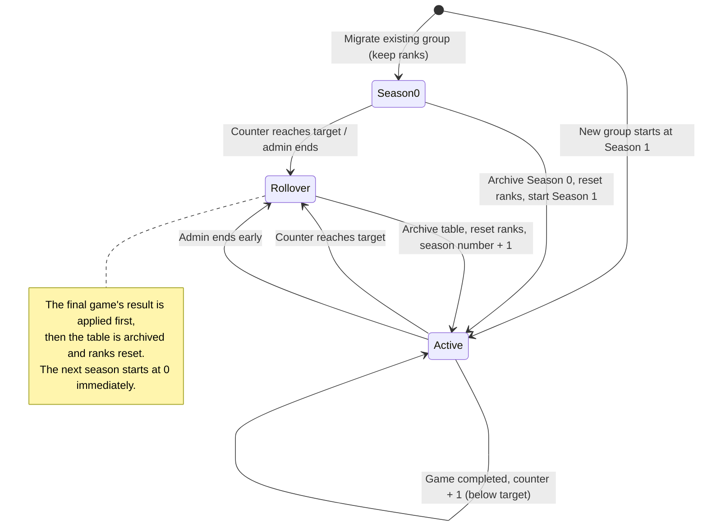

# Group seasons: implementation proposal

Proposal date: 15 October 2026. Status: planning only; no application or production data changes.

Open [the visual companion](seasons-proposal.html) for screen mockups and lifecycle diagrams. All mock names and scores are illustrative.

## 1. What we are building

A **season** is a competition period inside a group. It ends after a fixed **number of completed games**, or when an admin ends it early. Ending a season archives the final table and resets everyone to rank 0 for the next season, which starts immediately.

### Confirmed decisions

| Topic | Behavior |
| --- | --- |
| Season length | A number of **completed games** (not time). Proposed default **48**, admin-configurable per group. |
| Manual ending | A group admin can end the active season early, after confirmation. Blocked while a game is live ("finish the current game first"). |
| Reset | Every member starts the next season at rank 0, with wins, draws, and losses at 0. |
| History | The previous season's final table is kept as read-only history. |
| Renewal | The next season starts immediately when the current one ends (by count or manually). |
| Season-end recap | When a player next interacts with the app after their group's season ended, show a full-screen recap: season ended, their final rank and leaderboard position, and group stats. |
| Numbering | The feature launches with existing groups on **Season 0** (their current standings, carried over). The first fresh, reset season is **Season 1**. New groups created after launch start at Season 1. |
| Existing groups | **No reset at launch.** Current ranks carry over as the live **Season 0**. The first reset happens when Season 0 ends, starting Season 1 fresh. |

### Why count-based is the right fit here

Defining a season by games removes everything expensive or fragile about a time-based design:

- **No background scheduler** — nothing needs to run on a timer, so there is no recurring cost and no "did a year pass while the app was closed?" problem.
- **No clocks or timezones** — no `Intl`/calendar math, and no mobile WebView timezone risk.
- **No boundary limbo** — a season can only end *because a game finished*, never *during* a game. The game that reaches the target counts, then the reset happens right after it.

The trigger is an event that already happens today: a game being completed. That is the whole mechanism.

### Proposed defaults, subject to approval

- Default length **48 completed games**; admins can set a per-group value within a sane range (for example 5-200).
- Only **completed** games advance the counter. Cancelled/deleted games do not. A draw still counts as a completed game.
- Changing `gamesPerSeason` affects the **current** season immediately. The target must be an integer from 5 to 200 and greater than games already played; the service validates against the latest counter in a transaction.
- Keep history after members leave; preserve their display name as it was. Rejoining with the same player id resumes that archived record rather than erasing it.
- Do not add lifetime aggregates, medals, exports, or result corrections in the first release.

### The launch moment (no reset)

Launch is deliberately gentle: **no standings are wiped.** For each existing group we simply attach season fields and label the ongoing competition **Season 0**, keeping every current rank and stat exactly as it is. Season 0 then runs like any other season — its counter starts at 0 at launch (past completed games can't be recounted because finished games are deleted today) and it ends after `gamesPerSeason` games or an admin ending it early. When Season 0 ends, it is archived and **Season 1** starts fresh at zero. This means the first time anyone's ranks reset is a real, played-through season boundary — not an app update.

## 2. What the code does today

| Evidence | Consequence for seasons |
| --- | --- |
| [gameCompletion.js](../src/utils/gameCompletion.js) | Rank is a group-local 0-4 tier. Winner +1 (max 4), loser -1 (min 0), draw unchanged; W/D/L increment. |
| [groupStore.js](../src/store/groupStore.js), `completeGame` | Delegates to the service; ranks are not changed optimistically before a successful commit. |
| [gameService.js](../src/api/gameService.js), `completeGame` | Saves ranks, counter/archive/reset, debt, receipt, fixture deletion and recurrence in one transaction. A retry returns the immutable receipt without reapplying results. |
| [gameService.js](../src/api/gameService.js), `createGame` | Transactional `activeGameId` serializes new fixture creation. One fixture alone does not prevent two admins completing it, so completion also uses receipts. |
| [groupStore.js](../src/store/groupStore.js), rank-change tracking | A `rank:lastSeen:*` localStorage key drives the [RankChangeGate](../src/components/modals/RankChangeGate.jsx). On a reset this must be suppressed (it would look like a mass demotion); the season recap replaces it. A parallel `season:lastSeen:*` key detects when a season ended between visits. |
| [PreGamePage.jsx](../src/pages/PreGamePage.jsx), [TeamsPage.jsx](../src/pages/TeamsPage.jsx), [teamBalancer.js](../src/utils/teamBalancer.js) | Team balancing reads `player.rank`. After a reset everyone is 0, so the first games of a season balance evenly. This is acceptable and expected. |
| Top-level `players` collection ([playerService.js](../src/api/playerService.js)) | Does **not** track live rank/stats in practice, so there is only one source to reset, despite [data-model.md](data-model.md). Correct that doc. |

## 3. Design (lean)

Keep the current architecture (components -> stores -> services -> Firebase). Live ranks stay exactly where they are now, in `group.players[]`. Seasons add a small counter on the group and an archive of past tables.

### Data

| Location | Fields added / purpose |
| --- | --- |
| `groups/{groupId}` | `seasonNumber` (existing groups start at **0**; new groups at **1**), `gamesPerSeason` (config, default 48), `seasonGamesPlayed` (counter, starts 0), `seasonStartedAt` (informational). Live ranks remain in `players[]`. |
| `groups/{groupId}/seasons/{seasonId}` | Archived past season: `number` (0, 1, 2, …), `gamesPlayed`, `endReason: target \| manual`, `endedBy`, `endedAt`, and a `standings` snapshot (player id, name, rank, wins, draws, losses). Read-only. |

A group has at most a few dozen players, so a season's final table fits comfortably inline in one archive document — no extra subcollection or fan-out reads needed. There is no separate "baseline" document: Season 0 simply *is* the carried-over launch season and is archived normally when it ends.

Add a small `seasonService.js` (reset/end, read history) and fold a few fields into the existing group store. Add pure helpers (`shouldSeasonEnd(gamesPlayed, target)`, `resetPlayersForNewSeason(players)`, `buildSeasonRecap(standings, playerId)`) with unit tests next to them.

## 4. Lifecycle

### Game completion (extends today's `handleEndGame`)

1. Apply the result with the **current** rank rules (unchanged): winner +1 capped at 4, loser -1 floored at 0, draw unchanged; W/D/L increment for participating group players. Guests/injured non-participants do not gain standings.
2. Increment `seasonGamesPlayed` by 1.
3. If `seasonGamesPlayed >= gamesPerSeason`, roll over: snapshot the standings into `seasons/{seasonId}`, zero every player's `rank`/`stats`, set `seasonNumber + 1`, `seasonGamesPlayed = 0`, new `seasonStartedAt`.
4. Commit the result, any archive/reset, unpaid-debt record, completion receipt, deletion and recurring fixture together. A failure leaves the fixture and standings unchanged and shows a retryable error. A reset does **not** erase existing debts, payments, treasury, or membership.

### Season-end recap (per player, lazy)

The recap needs no background job — it is detected the next time each player opens the app, exactly like the existing rank-change gate:

- Each player's device stores `season:lastSeen:{authUid}:{groupId}` = the last season number they acknowledged. A new device also checks the latest ended season.
- All signed-in routes subscribe to the user's groups. When a season is unacknowledged, queue a full-screen **recap** for the latest archive, retaining separate recaps for multiple groups:
  - "Season N has ended" and the end reason.
  - The player's **final rank** and **leaderboard position**, with tied records sharing a position.
  - **Group stats**: champion/shared champions (none for a season without recorded participation), total games played, and the player's own W/D/L.
  - A single "Enter Season N+1" button to acknowledge; then set `season:lastSeen` to the current number.
- Suppress the per-game rank-down gate for the same transition, so a reset is never shown as a demotion. If several seasons elapsed between visits, show the most recent ended season and acknowledge up to the current one.
- `buildSeasonRecap(standings, playerId)` is a pure, unit-tested helper; the gate reuses the [RankChangeGate](../src/components/modals/RankChangeGate.jsx) full-screen pattern.

### Manual early end (admin only)

Same as a rollover minus the counter: archive the current table with `endReason: manual`, reset, and start the next season. **Blocked while a game is live** — the button shows "Finish the current game first." Because a season can only ever end at a game completion (automatic) or when no game is live (manual), there is never an in-progress game at a rollover. A game therefore never needs a season tag for correctness, and no cross-season result logic exists.

### Where this runs

The counter increment and rollover are initiated **client-side** and committed through Firestore transactions. This needs **no Cloud Function and no scheduler**. Usage still consumes Firestore reads/writes/storage; actual billing depends on the project's plan and usage.

Transactions read current standings and counters; immutable receipts prevent duplicate completion, including debt and recurrence duplication. Manual ending also checks the expected season and live-game pointer transactionally. Admins remain trusted writers under the existing permissions model. Older app tabs must reload before completing games because they do not use the new protocol.

## 5. UI

### Group screen

- A season card below the rank tiers: **Season 0 - 12 / 48 games** (existing groups at launch), with a progress indicator and history link.
- A season picker: current season plus past seasons (Season 0 onward).
- Leaderboard/highlights show the current season; a brand-new season shows an honest empty state ("No games played this season") with members at rank 0.
- On reset, the per-player **season recap** (above) is the moment players see; the per-game rank-down gate is suppressed for that transition.

### Season-end recap screen

- Full-screen, shown on the next interaction after the player's season ended. Content: "Season N ended", the player's final rank and position (e.g. 3rd of 12), group stats (champion, total games, the player's W/D/L), and an "Enter Season N+1" button. Reuses the existing full-screen gate styling, Lucide icons, and `t(...)` strings.

### Group settings (admin)

- **Games per season** control (default 48).
- **End season now** action with a confirmation that names the season, the reset effect, and states clearly that debts, payments, and membership are unchanged. Disabled while a game is live, with "Finish the current game first."
- Prevent double submission; keep the dialog open on failure with a retryable error.

### Season history

- Read-only final tables with rank and W/D/L, the end reason (target reached / ended early), and tied placements shown as ties. **Season 0** appears as the earliest entry — the launch season that carried over pre-seasons ranks — not as an all-time champion.

### Cross-cutting

Update the surfaces that read `player.rank`/`stats` so they read current-season values and show the season context: group/rank cards, [RankPage.jsx](../src/pages/RankPage.jsx), [GroupPage.jsx](../src/pages/GroupPage.jsx), highlights, and the rank-change gate. Add the new full-screen **season recap** component. Use Lucide icons, existing theme tokens, extracted styles, and `t(...)` keys added to **both** [en.js](../src/i18n/en.js) and [pt.js](../src/i18n/pt.js).

## 6. Migration (existing groups)

**No migration or deployment is authorized by this proposal.** When approved — note this is a **non-destructive** migration, since ranks are kept:

1. Back up Firestore and verify you can restore it (standard safety, even though nothing is reset).
2. Run a resumable Admin SDK script (dry-run by default, explicit `--apply`). Per group, in a transaction set `seasonNumber = 0`, `gamesPerSeason = 48` (or chosen default), `seasonGamesPlayed = 0`, `seasonStartedAt = now`. **Do not touch `players[]` ranks/stats.**
3. Leave membership, admins, treasury, payments, debts, RSVP, and any in-flight game untouched. An in-flight game simply belongs to Season 0 and finishes normally.
4. Verify every group has Season 0 with ranks **unchanged** from before, and that no debts/profiles changed. Re-running skips already-migrated groups. New groups created after launch start at Season 1.

Because nothing is wiped and ranks stay in `group.players[]`, this is a tiny additive write per group. Ship the season-aware client alongside so the first real reset (end of Season 0) surfaces the recap instead of a demotion.

## 7. Build sequence

| Phase | Scope | Done when |
| --- | --- | --- |
| A. Helpers + data | `shouldSeasonEnd`, `resetPlayersForNewSeason`, `buildSeasonRecap`, group fields, `seasonService` | Unit tests cover counter, reset, recap, and the preserved 0-4 rank rules |
| B. Completion + reset | Extend `handleEndGame`; admin "End season now"; archive snapshot | Completing the Nth game archives and resets exactly once; manual end works |
| C. UI | Season line + progress, picker, history, season-end recap screen, EN/PT copy | Fresh/active/ended screens render correct values; recap shows once; no false demotion |
| D. Rules + migration | Firestore rules for the `seasons` archive; resumable additive migration script | Rules tests pass; dry-run then verified non-destructive migration in staging |

Dependencies: A -> B -> C -> D. No scheduler, no new runtime dependency; reuse Firebase, React, Zustand, Lucide.

### Files likely touched

- Stores/services: [groupStore.js](../src/store/groupStore.js), [groupService.js](../src/api/groupService.js), new `seasonService.js` + helpers.
- Game flow: [GamePage.jsx](../src/pages/GamePage.jsx) (`handleEndGame`), [gameStore.js](../src/store/gameStore.js) if needed.
- Screens: [GroupPage.jsx](../src/pages/GroupPage.jsx), [RankPage.jsx](../src/pages/RankPage.jsx), [SquadSettingsPage.jsx](../src/pages/SquadSettingsPage.jsx), [_useSquadSettings.js](../src/pages/_useSquadSettings.js), rank/group cards, new season-recap component, [App.jsx](../src/App.jsx) (recap gate).
- Data/i18n/docs: [firestore.rules](../firestore.rules), [tests/rules](../tests/rules), [en.js](../src/i18n/en.js), [pt.js](../src/i18n/pt.js), [data-model.md](data-model.md), new migration script.

## 8. Acceptance checks

| Case | Expected outcome |
| --- | --- |
| Launch (existing group) | Group gains Season 0 with ranks/stats **unchanged**; counter at 0; nothing reset |
| Launch (new group) | New group starts at Season 1, everyone at rank 0 |
| Normal game | Rank/W/D/L change matches today's 0-4 algorithm; counter increases by 1 |
| Reaching target | The Nth completed game applies its result, archives the table, then resets everyone to 0; season number +1 |
| Manual end | Admin only; archives with reason "manual"; resets; starts next season immediately |
| Manual end during a live game | "End season now" is disabled/blocked with "finish the current game first"; no reset happens |
| Not auto-ending early | A game that leaves the counter below target never resets |
| Cancelled game | Does not advance the counter and does not reset |
| Season-end recap | On the next interaction after a season ended, the player sees a recap with their final rank, position, and group stats, exactly once; the rank-down gate is suppressed |
| Reset safety | Debts, payments, treasury, and membership are identical before and after a reset |
| Presentation | History tables are read-only; ties are shown; Season 0 is labelled as the launch season |
| Migration | Additive only — ranks unchanged; every group on Season 0; rerun is a no-op; no financial changes |
| i18n | All new strings exist in both en.js and pt.js |

Run the touched unit tests, `npm run test:rules`, then `npm run lint`, `npm run test:run`, and `npm run build`. Verify on a narrow mobile screen in light and dark themes. Any production deployment is a separate, explicit approval.
